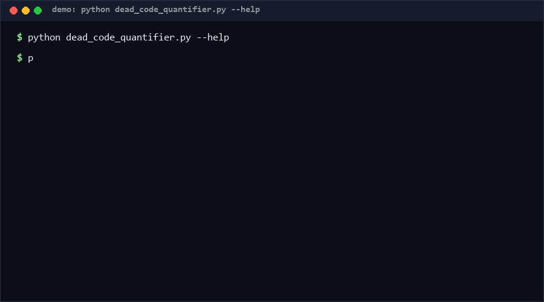

# dead-code-quantifier

Quantifies unreferenced definitions in Python code with two confidence modes: a conservative mode that only reports what is provably dead, and an aggressive mode that also flags unused variables, methods, and decorated defs. Pure `ast`, no execution, no dependencies.

<p align="center"></p>

## Problem

Dead code accumulates invisibly: functions nobody calls, constants nobody reads, methods orphaned by refactors. Full dead-code elimination requires whole-program analysis most teams don't have; meanwhile "just delete it" decisions stall because nobody can say how much code is actually affected. What is missing is a *measurement* tool with an explicit confidence dial, not another noisy linter.

## How it works

One `ast` pass per file collects definitions (functions, classes, module-level variables) and every loaded `Name` / attribute access across the scanned file set. A definition is dead when its name is never referenced, subject to mode:

- **Conservative** — top-level functions/classes only; anything decorated, dunder-named, named `main`, or listed in `__all__` is alive. Zero-risk report.
- **Aggressive** — additionally reports unused class methods, module-level variables, and decorated defs. Expect human review.

The report quantifies: dead definition count, dead LOC (`end_lineno - lineno + 1`), total LOC, and `dead_pct` — plus an optional `--gate` exit code for CI budgets.

## Quickstart

```bash
# Conservative scan of a package (~0.2s [estimated, repro: time python dead_code_quantifier.py scan src/])
python dead_code_quantifier.py scan src/

# Aggressive scan, JSON for tooling
python dead_code_quantifier.py scan src/ --mode aggressive --format json

# CI gate: fail when dead code exceeds 5% of LOC
python dead_code_quantifier.py scan src/ --gate 5.0

# Full self-test, 50 checks (~0.4s [estimated, repro: time python self_test.py])
python self_test.py
```

## How this differs (why-not-X)

No direct equivalent found as of 2026-10-11: the R13 precheck searched for same-mechanism (AST-level dead-code *quantification* with dual confidence modes) repositories and returned nothing with anchors. Adjacent tools differ in layer:

| Alternative | Relationship | How this repo differs |
|---|---|---|
| `vulture` (PyPI) | same-family detector | reports per-item deadness with its own confidence labels; this adds explicit dual modes, LOC quantification, `dead_pct`, and a CI gate on a percentage budget |
| `coverage.py` | dynamic measurement | measures what tests executed, not what code is referenced at all; static and dynamic answers complement each other |
| `ruff`/`flake8` (F401, unused imports) | import-level only | flags unused imports and locals, not project-level unreferenced functions/classes/variables across a file set |

## Minimal Fallback

Without this tool: `grep -rn "def my_func" src/ | wc -l` gives a crude per-function reference count (1 hit = definition only). You lose cross-file analysis, LOC math, and the mode dial — but it works in any shell for spot checks.

## Design Trade-offs

- **Name-based reference counting** — any `obj.parse()` keeps *every* `parse` alive (false negatives accepted); call-graph precision would need type inference and would break the "no execution, no deps" promise.
- **Self-recursion counts as usage** — a recursive but never-called function stays alive; flagging it requires interprocedural reachability, out of scope.
- **Aggressive mode reports, never deletes** — automation proposes; humans dispose.
- **LOC as the value metric** — line counts are crude (a 3-line stub vs a 300-line state machine weigh equally) but objective and diff-stable.

## Limits & Second-order Effects

- Dynamic dispatch, `getattr(name)`, plugin registries, and string-based exports can hide real usage → aggressive deletions can break production. Second-order: teams burned by one bad deletion often disable the tool entirely; run aggressive mode with review, conservative mode as the CI gate.
- Cross-file analysis is name-based only: two unrelated `helper()` functions keep each other alive.
- Generated code and framework callbacks (Django admin, pytest fixtures) look dead; exclude generated directories.
- Deleting dead code shrinks diff blame/history utility; keep the deletion commit separate and referenced.

## FAQ

**Is aggressive mode safe to auto-delete from?** No. It is a review list. Conservative mode is the one safe enough to gate CI.

**Why does a decorated function stay alive in conservative mode?** Decorators frequently register callbacks (routes, hooks, fixtures); proving them dead needs framework knowledge.

**Does it handle `if TYPE_CHECKING:` or re-exports?** Re-export strings in `__all__` count as usage; conditional-import subtleties are not modeled.

**When NOT to use this?** Do not use it on codebases with heavy metaprogramming or plugin architectures where name-based analysis is structurally blind; do not use the aggressive list as a deletion TODO without per-item verification; do not compare `dead_pct` across dissimilar projects as a quality KPI — it measures surface cruft, not maintainability.

## [Core Assumptions]

1. A definition whose name never appears as a loaded name or attribute in the scanned set is probably dead — probability, not proof.
2. Conservative bias is worth more than recall: one false deletion costs more than ten false "alive" verdicts.
3. LOC is an acceptable proxy for the cost of carrying dead code.
4. Scanned files are Python 3 text; syntax-broken files are reported as errors and skipped, never fatal.

---

*Confidence: medium-high — the AST mechanics are deterministic and fully self-tested; semantic limits (dynamic dispatch) are inherent to the approach. Content as of 2026-10-11.*

---

Part of the [zhengming-toolbox](https://github.com/chenhz01/zhengming-toolbox) — 55 purpose-built AI-engineering tools across neglected niches.

Related tools: [complexity-budget-gate](https://github.com/chenhz01/complexity-budget-gate) · [comment-drift-check](https://github.com/chenhz01/comment-drift-check) · [deprecated-api-scan](https://github.com/chenhz01/deprecated-api-scan)
